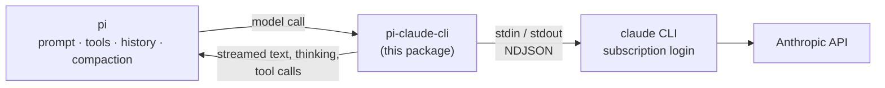
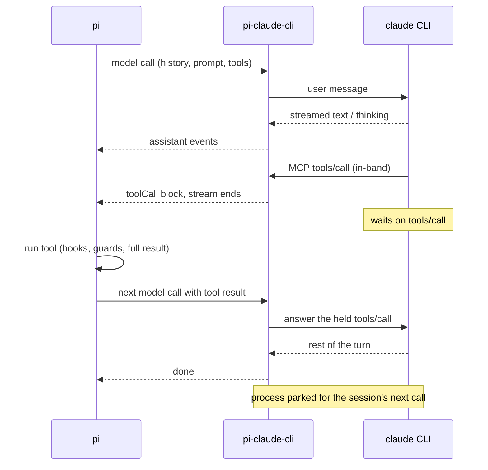
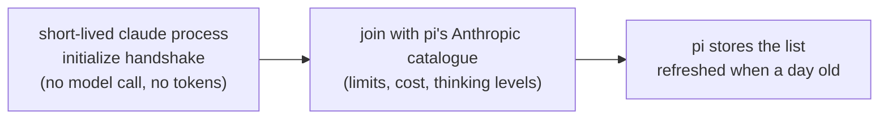

# pi-claude-cli

Use your Claude Pro/Max subscription from the [pi coding agent](https://github.com/earendil-works/pi). The official Claude Code CLI handles login and model access. pi keeps the prompt, the tools, the conversation and compaction.



This is a fork of [`agustinsacco/pi-claude-cli`](https://github.com/agustinsacco/pi-claude-cli), forked at 0.10.0. See [Differences from upstream](#differences-from-upstream).

## Quick start

1. Install Claude Code (2.1.265 or newer) and log in:

   ```bash
   claude auth login
   ```

2. Add the package to pi, either with `pi install git:github.com/dmmulroy/pi-claude-cli` or in pi's `settings.json`:

   ```json
   { "packages": ["git:github.com/dmmulroy/pi-claude-cli"] }
   ```

3. In pi, run `/model` and pick a model under `pi-claude-cli`.

**Requirements:** macOS or Linux, Node 22.18+, pi, and `claude` on `PATH`. Windows is not supported. No environment variables are required.

## Authentication

Claude Code owns the login; the provider never reads or extracts OAuth tokens.

| You want to…       | Do this                                      |
| ------------------ | -------------------------------------------- |
| Log in / log out   | `claude auth login` / `claude auth logout`   |
| Check what pi sees | `/pi-claude-cli-status` in pi                |
| Use pi's `/login`  | It only tells you to use `claude auth login` |

pi offers this provider's models while `claude auth status` says the CLI is installed and not logged out, and labels their cost "(sub)" for a Pro or Max login. The answer is cached in `auth-status.json` under the state directory (installed, logged in, plan, when; no account details) and refreshed in the background, so pi's start does not wait for the CLI. A CLI older than 2.1.265 is reported as an assistant error on the first model call.

## How it works

pi stays the only owner of the conversation. A Claude process is a disposable cache of pi's history, never a second ledger.

| pi owns         | What that means here                                                                                                                                                     |
| --------------- | ------------------------------------------------------------------------------------------------------------------------------------------------------------------------ |
| **Prompt**      | pi's system prompt replaces Claude Code's (plus a short note about the MCP tool-name prefix). Claude discovers no CLAUDE.md, skills or memory of its own.                |
| **Tools**       | Only the current request's tools are offered, through an MCP server hosted in-band on the CLI's own control channel. Every tool runs in pi. The CLI has no native tools. |
| **History**     | A warm process is reused only while its acknowledged history and launch settings still match pi's. Otherwise a fresh process gets pi's current history.                  |
| **Compaction**  | pi compacts. The CLI's auto-compaction and its own API retries are off.                                                                                                  |
| **Storage**     | `--no-session-persistence`: no Claude transcript, no `--resume`. Temp files live in a private directory removed at session shutdown (a SIGKILL can leave it).            |
| **Status line** | Nothing is written to pi's footer.                                                                                                                                       |

### A turn with a tool call

The CLI's tool call is held open while pi runs the tool, so the same process continues with the result:



### Warm or fresh

```text
on(model call)
  if a parked process has the same history prefix and launch signature
    send only the new messages                       # cheap
  else
    retire it, launch a fresh process, import pi's whole history
```

The launch signature is the model, system prompt, working directory, handoff mode and host settings file. Edits, compaction, a model switch, a prompt change, a pi restart or the idle timeout all mean a fresh process. Thinking-level and tool-list changes are applied to the live process instead.

### Cost of a fresh process

A fresh process pays for the whole history again: there is no prompt cache across processes (measured, not assumed). That is why a parked process waits an hour by default, as long as Claude Code's prompt cache lasts. Each parked process holds about 500 MB while it waits; `PI_CLAUDE_CLI_KEEPALIVE_MS` changes this.

By default the history goes in **structured**: the messages themselves, with real `tool_use` / `tool_result` blocks, as pi's own Anthropic provider would send them. Claude's signed thinking is replayed with its signatures while the message is unchanged and from the same model; otherwise as plain text. Tool call ids Claude would reject (from another provider) are mapped to valid ones on the wire; pi's stored ids never change.

A pi tool name the CLI would rewrite (the CLI turns anything outside `[a-zA-Z0-9_-]` into `_`) or that would not fit Claude's 64-character limit with the MCP prefix reaches the model under a stable alias such as `deploy_prod_1a2b3c4d`, and pi gets its calls under its own name.

Only one call at a time owns a pi session's parked process. A call that overlaps another of the same session (a background summary, say) runs on a process of its own, retired when it ends.

This relies on undocumented CLI stdin behaviour, checked against the real API on 2.1.299. On a CLI older than 2.1.292, or if the CLI does not confirm the import, the provider falls back to a **flat** import: one role-labelled text message, no thinking. `PI_CLAUDE_CLI_IMPORT=flat` always uses it.

Details: [docs/CONTEXT-POLICY.md](docs/CONTEXT-POLICY.md).

### Thinking

pi's thinking levels map to the request pi's own Anthropic provider would send: `off` disables thinking, other levels send pi's budget or effort with summaries. A level changed mid-session applies from the next turn without restarting the CLI.

## Usage-credit guard

Claude Code reports the subscription's limit status after each API call. When a call was charged to **usage credits** (formerly "extra usage") instead of plan limits:

```text
on(limit status says "usage credits")
  if PI_CLAUDE_CLI_ALLOW_USAGE_CREDITS=1
    continue
  else
    end the call with a "billing" error      # pi does not retry it
    if a tool call is already with pi
      stop the next call before the result is sent
```

The charged call is paid for, but pi's agent loop makes no more. Anthropic's refusal to serve a request on plan limits ("third-party apps now draw from your extra usage") is reported the same way. The latest status is kept on each assistant message as the `pi-claude-cli.rate-limit` diagnostic.

## Configuration

All optional. A value that does not parse falls back to its default.

| Variable                            | Default      | Purpose                                                                        |
| ----------------------------------- | ------------ | ------------------------------------------------------------------------------ |
| `PI_CLAUDE_CLI_KEEPALIVE_MS`        | `3600000`    | Idle lifetime of a parked process; `0` parks nothing                           |
| `PI_CLAUDE_CLI_TIMEOUT_MS`          | `300000`     | Longest stdout silence while a call is attached; then an error and a kill      |
| `PI_CLAUDE_CLI_MAX_PARKED`          | `4`          | Most processes parked at once; parking one more retires the longest-parked     |
| `PI_CLAUDE_CLI_HANDOFF_WAIT_MS`     | `1800000`    | Maximum wait for pi to answer a tool call                                      |
| `PI_CLAUDE_CLI_HANDOFF_PROXY`       | on           | `0` interrupts the turn at each tool call instead of holding it open           |
| `PI_CLAUDE_CLI_IMPORT`              | `structured` | `flat` gives a fresh process the history as one text message                   |
| `PI_CLAUDE_CLI_MODELS`              | account      | `builtin` lists pi's whole Anthropic catalogue instead of the account's models |
| `PI_CLAUDE_CLI_THINKING_DISPLAY`    | `summarized` | `omitted` returns no thinking summaries                                        |
| `PI_CLAUDE_CLI_ALLOW_USAGE_CREDITS` | unset        | `1` lets model calls be charged to usage credits                               |
| `PI_CLAUDE_CLI_SETTINGS`            | unset        | Explicit Claude Code settings file (hooks, permissions) passed as `--settings` |
| `PI_CLAUDE_CLI_TRACE`               | daily file   | Trace file path, or `off`; see [Traces](#traces)                               |
| `PI_CLAUDE_CLI_TRACE_WIRE`          | counts       | `1` records one event per wire message; `raw` records raw lines, with content  |
| `MCP_TOOL_TIMEOUT`                  | `3600000`    | CLI-side MCP call timeout                                                      |

**Never forwarded to the CLI**, because they would move it off the subscription login: `ANTHROPIC_API_KEY`, `ANTHROPIC_AUTH_TOKEN`, `ANTHROPIC_BASE_URL`, `ANTHROPIC_FOUNDRY_API_KEY`, `ANTHROPIC_FOUNDRY_AUTH_TOKEN`, `ANTHROPIC_AWS_API_KEY`, and the switches `CLAUDE_CODE_USE_BEDROCK`, `CLAUDE_CODE_USE_MANTLE`, `CLAUDE_CODE_USE_VERTEX`, `CLAUDE_CODE_USE_FOUNDRY`, `CLAUDE_CODE_USE_ANTHROPIC_AWS`. A host's `CLAUDE_CODE_EXTRA_BODY` is dropped too. Explicit host guards and managed policy still apply.

## Models

On pi 1.x the list is your account's:



Models pi's catalogue does not know yet are added with conservative limits. Before the first refresh, when the CLI cannot be asked, and on pi before 1.x, the list is pi's whole Anthropic catalogue. The CLI's list is its model picker, not an access check: a missing model may still run. `PI_CLAUDE_CLI_MODELS=builtin` keeps the whole catalogue.

## What's on pi's message

Besides the model's output, each assistant message carries what pi's own Anthropic provider records: `responseId`, the raw stop reason, the usage breakdown (1-hour cache write share, thinking share of output) and, on adaptive models, `providerThinkingLevel`. The `pi-claude-cli.rate-limit` diagnostic holds the latest limit status. Signed thinking is stored under a `piClaudeCli` key, not in `diagnostics`, which pi's bug report collects. None of this is sent to the model.

## Traces

Every model call, CLI launch, process lifetime, tool call and retirement is a span, written as NDJSON:

```text
~/.local/state/pi-claude-cli/traces/     # or $XDG_STATE_HOME/pi-claude-cli/traces/
└── <date>.ndjson                        # 0600 files in a 0700 directory, pruned after 7 idle days
```

Traces are **not a transcript**: ids, tool names, sizes, counts and durations, never prompt text, tool arguments or tool results. The one exception is `PI_CLAUDE_CLI_TRACE_WIRE=raw`, for protocol debugging. `PI_CLAUDE_CLI_TRACE=<path>` writes elsewhere, `=off` writes nothing. A failed write turns tracing off for the session and never fails a model call.

From a checkout:

```bash
vp run trace -- tree --last     # the most recent model call, as a span tree
vp run trace -- ls              # one line per trace
vp run trace -- open            # spans that never ended
vp run trace -- stats           # count and duration by span name
```

## Differences from upstream

```diff
 pi-claude-cli
-├── observer mode: native Claude tools, --resume, session-map sidecar,
-│   tool markers, sub-agent tracking, CLI-owned compaction
-├── PI_CLAUDE_CLI_CONTEXT / _SYSTEM_PROMPT / _AUTOCOMPACT / _TOOL_RESULTS /
-│   _HERMETIC / _STRICT_MCP / _EPHEMERAL
-├── schema-only MCP server: node child per process, unix socket, shared secret
-├── status-line keys claude-rate-limit, claude-subagents
-├── Windows support, cross-spawn
-├── npm package
+├── one execution path: pi owns prompt, tools, history, compaction
+├── rewritten on Effect 4: one scope per CLI process, one fiber per call
+├── in-band MCP, per-process tool surface (fixes upstream #49)
+├── traces: on by default, private, content-free
+├── subscription-override env vars stripped
+├── usage-credit guard, refusals as errors, stream checked against the CLI's record
+├── auth check hides models when the CLI is missing or logged out
+└── captured stderr capped at the latest 64 KiB per process
```

Upstream #49: [a concurrent tool-less request could leave the main turn without tools](https://github.com/agustinsacco/pi-claude-cli/issues/49). The design record of the rewrite is [effect-rewrite.md](effect-rewrite.md).

## Development

```text
index.ts                      # registers the provider, auth check, models, /pi-claude-cli-status
src/
├── provider-runtime.ts       # Effect runtime; one fiber per pi model call
├── episode.ts                # one model call: take or launch, stream, hand off, park
├── claude-process-pool.ts    # launches processes, parks one per pi session
├── claude-process.ts         # one CLI process and everything it owns
├── claude-cli.ts             # launch flags and environment
├── mcp-inband.ts             # in-band MCP server for pi's tools
├── event-bridge.ts           # CLI stream events → pi messages
├── pi-context.ts             # history import and hashing
└── …                         # see AGENTS.md
scripts/                      # trace CLI, scenarios, e2e
tests/                        # unit tests, stub CLI, opt-in live tests
```

```bash
vp install
vp check                      # format, lint, types
vp test                       # unit tests
vp run test:coverage          # unit tests with coverage floors
vp run test:scenarios         # provider against a stub CLI, checked by trace assertions
vp run test:e2e               # real pi, stub CLI
vp run trace -- tree --last
vp run ready                  # check, unit, scenarios and e2e together
```

Scripts are TypeScript run directly by Node (22.18+). `test:scenarios` and `test:e2e` need `pi` on `PATH`. To try the working tree in pi: `pi -ne -e <repo>`.

The opt-in live checks spend subscription tokens in a disposable workspace:

```bash
node scripts/scenarios.ts --live
PI_OWNED_LIVE=1 vp test tests/live-pi-roundtrip.test.ts tests/live-thinking.test.ts tests/live-structured-import.test.ts
```

Contributor notes: [AGENTS.md](AGENTS.md), [docs/coding-standards.md](docs/coding-standards.md).

## License

MIT. See [LICENSE](LICENSE). Forked from [agustinsacco/pi-claude-cli](https://github.com/agustinsacco/pi-claude-cli).
