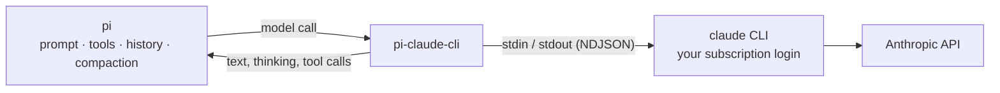
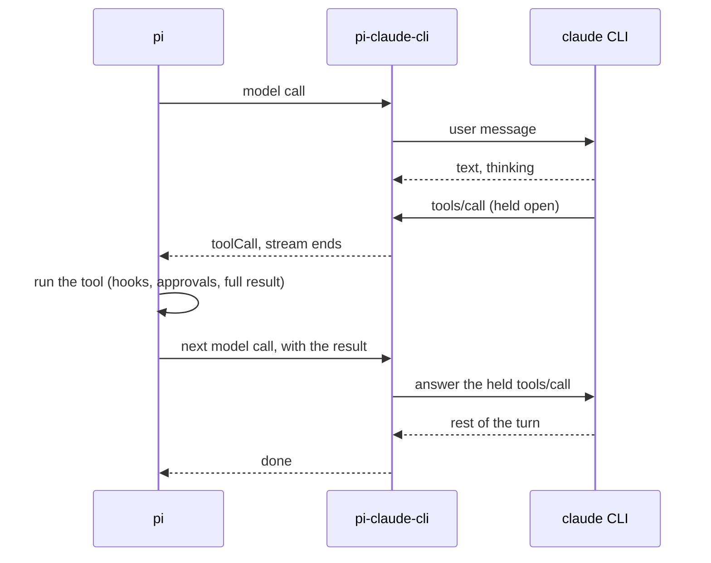
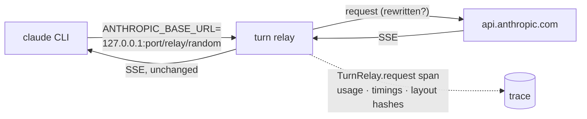

# pi-claude-cli

Use your Claude Pro or Max subscription in [pi](https://github.com/earendil-works/pi). The official Claude Code CLI does the login and talks to the model. pi keeps everything else: the prompt, the tools, the conversation and compaction.



A fork of [`agustinsacco/pi-claude-cli`](https://github.com/agustinsacco/pi-claude-cli), rewritten on Effect 4 with one execution path. It borrows ideas from pi's own [`pi-claude-code`](https://github.com/earendil-works/pi-claude-code).

## Quick start

```bash
claude auth login                                  # Claude Code 2.1.265 or newer
pi install git:github.com/dmmulroy/pi-claude-cli
```

Then run `/model` in pi and pick a model under `pi-claude-cli`.

You need macOS or Linux, Node 22.18+, and `claude` on your `PATH`. Windows is not supported. No configuration is required.

## Logging in

Claude Code owns the login. This package never reads, copies or refreshes your credentials.

| To…                | Run                                              |
| ------------------ | ------------------------------------------------ |
| log in or out      | `claude auth login` / `claude auth logout`       |
| check what pi sees | `/pi-claude-cli-status` in pi                    |
| use pi's `/login`  | don't: it only points you at `claude auth login` |

pi lists the models while `claude auth status` says you are logged in, and labels their cost "(sub)" on a Pro or Max plan. The answer is cached on disk and refreshed in the background, so pi starts without waiting for the CLI.

## How a call works

Every pi model call is one **episode**. It borrows a Claude process, streams the answer to pi, and parks the process for the next call.

```text
runEpisode
  pool.take(session)              # the parked process, and this call's lease
  decide: turn | handoff | spawn
    turn     → write the new user message
    handoff  → answer the held tool calls with pi's results
    spawn    → launch a process, import pi's whole history
  read the CLI's stream → pi events
  pool.park(lease, process)       # or retire it in the background
```

### Tool calls stay open

The CLI has no tools of its own. pi's tools are offered through an MCP server that runs inside the CLI's own control channel, with no socket and no extra process. When the model calls one, the CLI waits on it while pi runs the tool:



The next call continues the same process only when its results are exactly the calls the CLI is waiting on, each once. Anything else (a missing result, a new user message instead) retires the process and starts fresh.

### Warm or fresh

```text
on(model call)
  if the parked process acknowledged exactly this history's prefix
     and its model, prompt and cwd match
    send only what is new                        # warm
  else
    retire it, launch a fresh process, import the history
```

Thinking-level and tool-list changes are applied to the live process; they don't force a fresh one. A fresh process gets the history **structured**: real messages, `tool_use` / `tool_result` blocks, and Claude's signed thinking while the message is unchanged. On a CLI older than 2.1.292, or one that refuses the import, it falls back to one labelled text message.

### Who owns what

| pi owns     | Here                                                                       |
| ----------- | -------------------------------------------------------------------------- |
| the prompt  | pi's system prompt replaces Claude Code's. No CLAUDE.md, skills or memory. |
| the tools   | only this call's tools, all run by pi                                      |
| the history | a Claude process is a disposable cache of it, never a second ledger        |
| compaction  | the CLI's auto-compaction and its own retries are off                      |
| storage     | `--no-session-persistence`: no transcript, no `--resume`                   |

## Processes and memory

Each parked process holds about 500 MB. The pool keeps one per pi session, for an hour by default (as long as the prompt cache lasts), and at most four in total.

```text
on(park)
  if another call of this session holds the lease → retire this one
  keep it for the session
  while more than 4 are parked
    retire the longest-parked, preferring one not inside a tool call
```

A call that overlaps another in the same session runs on a process of its own, which is retired when it ends.

## The turn relay

`PI_CLAUDE_CLI_RELAY` puts a small loopback HTTP relay between each CLI process and the API. The CLI keeps its own login: the relay forwards its authorization header to `https://api.anthropic.com`, nowhere else, and never stores or traces it.



| Mode      | Does                                                                                                                                                       |
| --------- | ---------------------------------------------------------------------------------------------------------------------------------------------------------- |
| `off`     | the CLI talks to the API itself                                                                                                                            |
| `shadow`  | records every request: status, timings, usage, and one hash per message and system block                                                                   |
| `rewrite` | the default: records, and also moves Claude Code's session context back to message 0, and keeps pi's later system messages where they occurred (see below) |

**Why `rewrite`.** Claude Code attaches two reminders, your session context and today's date, to the first message it sends the model. On a first turn that is message 0. In a process that imported a history it is the _last_ message, so every fresh process diverges from the previous request and misses the prompt cache. `rewrite` puts them back where a first turn has them, byte for byte, and sends anything it doesn't recognise as it came.

It knows both layouts 2.1.299 uses:

```text
older models     first turn  m0 [env, model, context, date, prompt]
                 import      m0 [env, model, prompt] … last [… context, date]
system-message   first turn  m0 [context, prompt]  m1 system "env … date"
models           import      m0 [prompt]  m1 system "env" … last [context, …]  system "date"
```

**pi's system messages.** pi can add a system message mid-conversation (a prompt section changed, an instruction for what follows). On a model that takes system messages mid-conversation (Opus 4.8, the 5-series), with `rewrite`, the relay sends each one where it occurred, before the assistant message that followed it, as pi's own Anthropic provider does. The process launches with the leading prompt, so an update needs no fresh process and keeps the cache. On other models, or with the relay off or in `shadow`, every system message is folded into the current prompt, and a changed prompt starts a fresh process.

```text
on(request)
  for each later pi system message
    insert { role: "system", text } before the assistant message that followed it
    (none followed yet, or a flat import: at the end)
```

| Measured on 2.1.299      | Cache read on steady requests             |
| ------------------------ | ----------------------------------------- |
| warm process             | ~97%                                      |
| fresh process, `shadow`  | 0%                                        |
| fresh process, `rewrite` | 96–99% (Haiku 4.5, Sonnet 4.6, Haiku 5.5) |

A fresh process still pays for its launch and import, about 0.7 s at 50 tool rounds and 1.1 s at 200, so warm processes stay the main path and the relay makes the fresh ones (edits, compaction, restarts, evictions) cheap.

## Usage-credit guard

Claude Code reports your plan's limit status after every API call.

```text
on(limit status says "usage credits")
  if PI_CLAUDE_CLI_ALLOW_USAGE_CREDITS=1
    continue
  else
    end the call with a "billing" error         # pi does not retry it
    if a tool call is already with pi
      stop the next call before the result is sent
```

The charged call is already paid for; the guard stops pi's agent loop from making more. Anthropic refusing to serve a request on plan limits is reported the same way.

## Configuration

All optional. Set them in your shell or in pi's provider settings: the provider reads them through pi's auth hooks, as pi's own providers do.

| Variable                            | Default    | Purpose                                                 |
| ----------------------------------- | ---------- | ------------------------------------------------------- |
| `PI_CLAUDE_CLI_COMMAND`             | `claude`   | the Claude Code executable: a path, or a name on `PATH` |
| `PI_CLAUDE_CLI_CONFIG_DIR`          | unset      | Claude Code's config directory, as `CLAUDE_CONFIG_DIR`  |
| `PI_CLAUDE_CLI_ALLOW_USAGE_CREDITS` | unset      | `1` allows calls charged to usage credits               |
| `PI_CLAUDE_CLI_TRACE`               | daily file | trace file path, or `off`                               |

The CLI's silence limit is pi's own request timeout, `retry.provider.timeoutMs` (five minutes by default). Everything else is fixed: a parked process waits an hour (30 minutes inside a tool call), at most four are parked, history goes in structured with an automatic text fallback, thinking comes back summarized.

### Debugging

| Variable                   | Default   | Purpose                                                                                              |
| -------------------------- | --------- | ---------------------------------------------------------------------------------------------------- |
| `PI_CLAUDE_CLI_RELAY`      | `rewrite` | `shadow` records without rewriting; `off` bypasses the relay; see [the turn relay](#the-turn-relay)  |
| `PI_CLAUDE_CLI_RELAY_DUMP` | unset     | directory for relayed request bodies, as sent (`.json`) and as the CLI wrote them (`.cli`); content! |
| `PI_CLAUDE_CLI_TRACE_WIRE` | counts    | `1`: one event per wire message; `raw`: raw lines, content included                                  |

**Never passed to the CLI**, because they would move it off your subscription: `ANTHROPIC_API_KEY`, `ANTHROPIC_AUTH_TOKEN`, `ANTHROPIC_BASE_URL` (except the relay's own), `ANTHROPIC_FOUNDRY_API_KEY`, `ANTHROPIC_FOUNDRY_AUTH_TOKEN`, `ANTHROPIC_AWS_API_KEY`, and `CLAUDE_CODE_USE_BEDROCK` / `_MANTLE` / `_VERTEX` / `_FOUNDRY` / `_ANTHROPIC_AWS`. A host's `CLAUDE_CODE_EXTRA_BODY` is dropped as well. Managed policy still applies.

## Models

On pi 1.x the list is your account's, asked from a short-lived CLI process (no model call, no tokens) and joined with pi's Anthropic catalogue for limits, prices and thinking levels. pi refreshes it daily. Models pi doesn't know yet get conservative limits. Before the first refresh, or when the CLI can't be asked, you get pi's whole catalogue.

## What's on pi's message

Besides the model's output, each assistant message carries what pi's own Anthropic provider records: `responseId`, the raw stop reason, the usage breakdown and `providerThinkingLevel`. The latest limit status is the `pi-claude-cli.rate-limit` diagnostic. Signed thinking is stored under a `piClaudeCli` key, outside `diagnostics`, because pi's bug report collects those. None of it is sent to the model.

## Traces

Every call, launch, process, tool call, relayed request and retirement is a span, written as NDJSON:

```text
~/.local/state/pi-claude-cli/traces/
└── <date>.ndjson        # 0600 files, pruned after 7 idle days
```

Traces hold ids, names, sizes, counts and durations: never prompt text, tool arguments or results (unless you set `PI_CLAUDE_CLI_TRACE_WIRE=raw`). From a checkout:

```bash
vp run trace -- tree --last      # the latest call as a span tree
vp run trace -- stats            # count and duration by span name
vp run trace -- open             # spans that never ended
```

## Development

```text
index.ts                    registers the provider; no Effect, loads the runtime lazily
src/
├── provider-runtime.ts     the boundary with pi: one fiber per call, one terminal event
├── episode.ts              one model call: take or launch, stream, hand off, park
├── episode-mode.ts         pure choice of turn | handoff | spawn
├── claude-process-pool.ts  launching, leases, parking, the cap
├── claude-process.ts       one CLI process and all it owns, in one scope
├── claude-cli.ts           launch flags and environment
├── mcp-inband.ts           pi's tools as an in-band MCP server
├── turn-relay.ts           the loopback relay and its records
├── relay-rewrite.ts        the session-context rewrite and system messages (pure)
├── event-bridge.ts         CLI stream events → pi messages
├── pi-context.ts           pi history → structured or flat import
└── tracing.ts              the span sink
scripts/scenarios.ts        every stub scenario and its trace assertions
tests/e2e/claude-stub.cjs   a deterministic stand-in for the CLI
```

```bash
vp install                 # pnpm via Vite+
vp run ready               # check, unit tests, coverage, scenarios, e2e
node scripts/scenarios.ts --live   # spends subscription tokens
```

Read [AGENTS.md](AGENTS.md) before changing behaviour, then [docs/CONTEXT-POLICY.md](docs/CONTEXT-POLICY.md) and [docs/coding-standards.md](docs/coding-standards.md).
